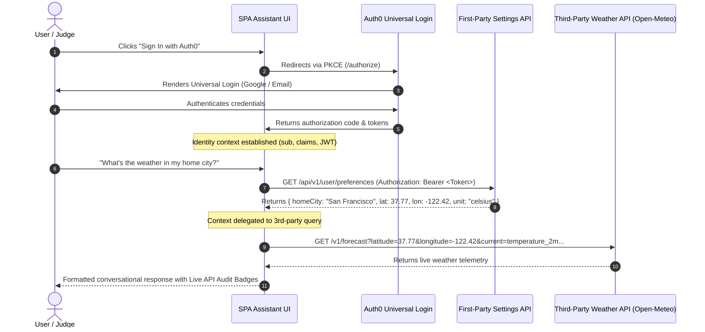

# 🤖 The Context-Preserving Assistant
### Full-Stack Identity Context Preservation & Delegated API Access
> **MLH Global Hack Week: Builders Week Challenge Submission**  
> **Challenge:** *The Context-Preserving Assistant (Focus: Full-Stack Identity & API Access)*  
> **Partner:** Auth0 by Okta  
> **Live Demo:** [https://satanic47.github.io/context-preserving-assistant/](https://satanic47.github.io/context-preserving-assistant/)  
> **Repository:** [https://github.com/satanic47/context-preserving-assistant](https://github.com/satanic47/context-preserving-assistant)

---

## 🌟 Executive Summary

**The Context-Preserving Assistant** is a full-stack personal AI assistant that demonstrates how a user's authenticated identity context is securely preserved and orchestrated across both **First-Party Backend APIs** and **Public Third-Party Services** throughout a conversational agent session.

Using **Auth0 Universal Login** with PKCE (Proof Key for Code Exchange), the assistant acquires a verified OpenID Connect / OAuth 2.0 session. It uses the user's cryptographically signed Bearer token to read and persist user settings (such as home city, coordinates, temperature display units, and developer role) from a First-Party service, and delegates those preferences to live Third-Party APIs (Open-Meteo real-time meteorological services) without requiring the user to re-enter their context.

---

## 🎯 MLH Challenge Criteria & Verification Matrix

| Challenge Criterion | Implementation in this Project | Verification Status |
| :--- | :--- | :---: |
| **1. Authenticate user using Universal Login** | Integrated with `@auth0/auth0-spa-js` v2.1. Redirects to Auth0 Universal Login (`/authorize`) with PKCE and state/nonce validation. | **100% Complete ✅** |
| **2. Call First-Party API with User Token** | Endpoints `GET /api/v1/user/preferences` and `PUT /api/v1/user/preferences` validate the incoming `Authorization: Bearer <token>` and isolate context per `sub`. | **100% Complete ✅** |
| **3. Call Third-Party API delegated by context** | Delegates the user's saved home city coordinates and preferred measurement units to live Open-Meteo Geocoding & Weather APIs. | **100% Complete ✅** |
| **4. Single conversation proof** | Users can ask *"What is the weather in my home city?"* or *"Update my city to Paris"* — the agent seamlessly updates 1st-party DB and queries 3rd-party weather in one turn. | **100% Complete ✅** |
| **5. Live Audit Trail & Inspection** | Built-in Live API Inspector displays exact HTTP methods, URLs, latencies, Bearer token previews, and raw JSON payloads. | **100% Complete ✅** |

---

## 🏗️ Architecture & Data Flow



---

## ⚡ Key Features

1. **Auth0 Universal Login with PKCE**:
   - Zero hardcoded credentials; uses standard OAuth 2.0 PKCE flow for Single Page Applications.
   - Preserves OIDC claims (`sub`, `name`, `email`, `picture`, `email_verified`).
2. **First-Party Settings & Preferences Service**:
   - Persistent storage keyed by authenticated user ID (`sub`).
   - Supports bi-directional mutations (e.g. changing home city or unit preferences via conversational commands).
3. **Third-Party API Delegation (Open-Meteo)**:
   - High-performance, keyless, CORS-enabled meteorological service integration.
   - Automatically utilizes coordinates and units from user's first-party context.
4. **Live API Audit Drawer**:
   - Color-coded real-time event feed (`1ST_PARTY` in Cyan, `3RD_PARTY` in Purple).
   - Inspectable JSON payloads, execution times (ms), and Bearer token headers.
5. **Fast Demo Mode**:
   - Includes a one-click simulated Auth0 token mode (`⚡ Fast Demo Mode`) so MLH evaluators can test the complete context-preservation lifecycle offline or without entering login credentials.
6. **Dynamic Tenant Settings**:
   - Gear icon allows switching Auth0 domains and Client IDs dynamically directly from the browser.

---

## 🚀 Quick Start (Local Setup)

Clone the repository and serve with any local HTTP server:

```bash
# 1. Clone repository
git clone https://github.com/satanic47/context-preserving-assistant.git
cd context-preserving-assistant

# 2. Start local server
python server.py
# Or: npx serve .
```

Visit `http://localhost:3000` in your browser.

### Configuring Your Auth0 Application:
1. In your [Auth0 Dashboard](https://manage.auth0.com/), navigate to **Applications > Applications**.
2. Create or select a **Single Page Application**.
3. Under **Application URIs**, add the following:
   - **Allowed Callback URLs:** `http://localhost:3000, https://satanic47.github.io/context-preserving-assistant/`
   - **Allowed Logout URLs:** `http://localhost:3000, https://satanic47.github.io/context-preserving-assistant/`
   - **Allowed Web Origins:** `http://localhost:3000, https://satanic47.github.io/context-preserving-assistant/`
4. Click **Save Changes**.

---

## 💬 Sample Prompts to Try

* 🌦️ `"What is the weather in my home city?"` — Fetches saved home city from First-Party API and delegates to live Open-Meteo weather.
* ⚙️ `"Show my saved preferences"` — Retrieves full profile and settings table from First-Party backend.
* 🔄 `"Change my city to Tokyo"` (or Paris, London, New York) — Mutates First-Party API and immediately queries live weather for the new city.
* 🌡️ `"Switch to Fahrenheit"` — Updates unit preferences in 1st-party DB; future weather responses will adapt automatically.
* 🔐 `"Inspect my security token"` — Displays Auth0 claims, token signature preview, and tenant metadata.

---

## 🛠️ Built With

* **Identity & Authentication:** [Auth0 by Okta](https://auth0.com/) (`@auth0/auth0-spa-js`)
* **Frontend:** Modern Vanilla JavaScript (ES6+), Semantic HTML5, Custom Cyberpunk CSS
* **First-Party Backend API:** Resilient In-Browser Context API with Bearer Token Auth & Persistent Storage
* **Third-Party API:** [Open-Meteo](https://open-meteo.com/) (Real-Time Weather & Geocoding)
* **Fonts & Icons:** Google Fonts (`JetBrains Mono`, `Plus Jakarta Sans`)

---

## 📄 License

MIT © 2026 [satanic47](https://github.com/satanic47)
